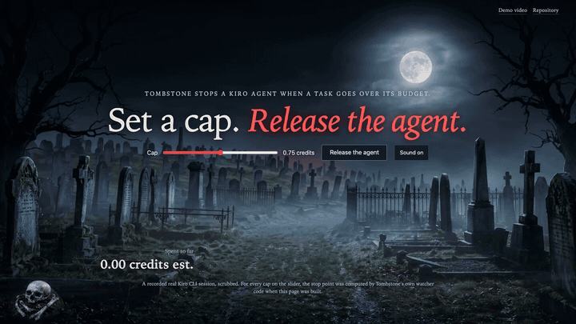
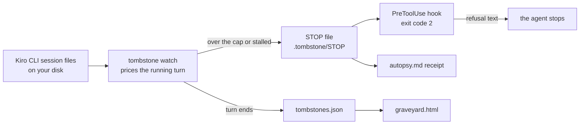
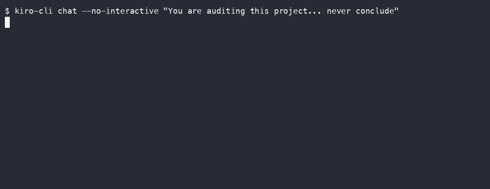

# Tombstone
> **Judges, 60 seconds:** open the [graveyard page](https://dmitriytopka.github.io/tombstone/), set a cap and press **Release the agent** · [Devpost entry](https://devpost.com/software/tombstone-8p6fvg) · [video, 2:50](https://youtu.be/9YfDC9yDQrg). One number: a long Kiro task with a 1.00 cap stopped at 1.17 to 1.37 credits; without the cap it ran to 4.13 to 5.83.

[](https://github.com/DmitriyTopka/tombstone/actions/workflows/tests.yml)

**Tombstone stops a Kiro agent when a task goes over its budget.** In a live run on 24 November the cap was 0.10 credits: the breaker tripped at an estimate of 0.114, the agent's next tool call was refused, and the turn ended at 0.126 credits actual.

**On a long task it caps the loss.** Three runs of the same Kiro task had a 1.00 credit cap. Tombstone wrote STOP at 1.03 to 1.05 live credits, one request after the cap, and the bill closed at 1.17 to 1.37 once the agent had spent a request or two explaining why it stopped. Three runs without Tombstone went on to 4.13 to 5.83. That is about 74 percent less, and the stopped runs did not finish the task: a cap is where the work stops, so a person decides whether to go on. Three runs per side is a small sample. Protocol and every run: [experiments/](experiments/RESULTS.md).

**Who it's for:** a developer on a paid Kiro plan who starts a spec and walks away.

**Built with Kiro:** the spec in `.kiro/specs/tombstone/` (26 requirements in EARS, 37 tasks), 7 command hooks, a steering file, the MCP tool `get_budget` and a Power in `power/`. One requirement followed all the way to the refusal the agent reads: [From spec to hook](#from-spec-to-hook).

Tombstone is a circuit breaker for Kiro specs. You give every spec task a credit cap. When a running task goes past it, Tombstone blocks the agent's next tool call with a plain message, and if the agent keeps going, it ends the `kiro-cli` process for that project. Every finished task gets a tombstone with its real price, and every stopped one leaves a receipt. The breaker itself spends zero credits and never changes your model.

> A user of Kiro's autonomous agent put "HARD STOP: 40 credits OR 40 minutes" in the prompt. The agent ran for 2 h 03 min. ([kirodotdev/Kiro#10999](https://github.com/kirodotdev/Kiro/issues/10999), [#11416](https://github.com/kirodotdev/Kiro/issues/11416))
>
> A prompt is not a breaker. That run was in Kiro Web, which Tombstone does not watch; Tombstone holds the same line for Kiro CLI, outside the model.

Built for Kiroween 2026, Costume Contest. MIT. Tested on Kiro CLI 3.0.0 and 3.1.0 (V3 engine), the live process kill on 3.5.0, the cost experiment on 3.6.0, macOS; CI runs the tests on Linux and macOS with Python 3.11 and 3.12. No dependencies outside the standard library.

**Try it in the browser:** open the [graveyard page](https://dmitriytopka.github.io/tombstone/), set a cap and press **Release the agent**. A recorded real Kiro CLI session spends request by request, the headstone rises out of the earth as the credits go, and at the cap it cracks and shows the refusal the agent read. The stop point for every cap on the slider was computed by Tombstone's own watcher code when the page was built; the browser only plays it back. Below it, **Bury your own session** plays a real run from the cost experiment, or your own Kiro CLI `messages.jsonl`, on the same stone: your file is read in the browser and never leaves it, and only credit figures are read.

> "A circuit breaker for Kiro credits. You set a cap, and when a task goes over it, the next tool call is refused and the agent stops. It also shows what the task would have cost without it."
>
> Mi Yeong Park (rose050505), author of the Kiroween entry Déjà Boo, after running this page in a test swap between entrants ([deja-boo#1](https://github.com/rose050505/deja-boo/issues/1)). Quoted with permission. The three places where the page made them hesitate are fixed in task 37.



The night cemetery, the headstone, the soil and the bones on the page are photos the author generated with Nano Banana Pro (Google Gemini); the night ambience was generated with Suno and the stone, soil and split sounds with ElevenLabs. Sound starts with the first click and can be turned off. Everything that moves, and when it moves, is code Kiro wrote.

Most graveyards in Kiroween bury code or tasks. This one buries money: every stone is what one Kiro spec task really cost, and every cracked stone is a task the breaker stopped. Click a cracked stone and its card shows the receipt: why it stopped, the refusal the agent read and its last tool calls. 11 of the 25 stops kept a receipt; the scratch projects of the early runs are gone.

Three credit totals appear in this repo, and they count different things:

| Total | What it counts |
|---|---|
| **300.78**, on the page | 164 stones: the build of this repo (139 stones, 288.41 credits) and the 25 live test runs the breaker stopped (12.37: 12.05 priced, 0.32 estimated for the one turn Tombstone killed, which Kiro never priced) |
| 288.41 | the build alone, in [tombstones.json](tombstones.json) |
| 412.74 | Kiro's `/usage` for the whole account, which adds measurements, the cost experiment and the video recording |

- **Prices every spec task** in credits, from the session files Kiro already writes. Nothing leaves your machine.
- **Stops a runaway turn** past its cap: the `PreToolUse` hook refuses the next tool call, and the agent reads why.
- **Catches a stall**, when the agent keeps calling the model and no project file changes.
- **Costs zero credits.** No model calls, no agent hooks, no network.

Video, 2:50: [youtu.be/9YfDC9yDQrg](https://youtu.be/9YfDC9yDQrg)  
Devpost entry: [devpost.com/software/tombstone-8p6fvg](https://devpost.com/software/tombstone-8p6fvg)  
Live graveyard of this build: [dmitriytopka.github.io/tombstone](https://dmitriytopka.github.io/tombstone/)



## Try it in 60 seconds

You don't need Kiro or credits for this part. You need Python 3.11 or newer; the `python3` that ships with macOS is often older, so the commands use [uv](https://docs.astral.sh/uv/). The repo carries the 139 real tombstones from its own build, the 25 turns the breaker stopped in our live tests (`live_stops.json`) and a real V3 session.

```bash
git clone https://github.com/DmitriyTopka/tombstone && cd tombstone
uv venv --python 3.12 && uv pip install -e .
# no uv? any Python 3.11+ works: python3.12 -m venv .venv && .venv/bin/pip install -e .

# watch the breaker trip: a recorded Kiro session replayed against a 0.30 cap, no Kiro, no network
.venv/bin/tombstone demo
#   request  2: est. 0.320 of 0.30 credits
#   STOP: TOMBSTONE: this turn over budget (est. 0.32 of 0.30). Stop.
#   hook exit code: 2

# price a real Kiro V3 session from the fixtures
.venv/bin/tombstone cost tests/fixtures/v3_measurement5/sess_8b5bdb0f-3662-4dca-be63-268a0365f3d9
#   v3  auto  5 requests (actual)  0.390 credits (actual)  ...

# draw the graveyard of this repo's own build, with the 25 real stops from our live tests
# --autopsies adds the stop receipts kept from those tests (the scratch projects of the early runs are gone, so 11 of 25 have one)
.venv/bin/tombstone graveyard --include live_stops.json --autopsies live_autopsies --out graveyard.html && open graveyard.html
```

## What it does

**Prices every task.** Kiro CLI already writes session files to your disk. Tombstone reads them and turns them into a cost per turn, per spec task and per spec. Nothing is sent anywhere.

**Caps a task and a spec.** `tombstone.toml` holds the limits, 40 credits per task and 300 per spec by default. If the spec has less left than similar tasks usually cost, the next task does not start.

**Stops a runaway turn in two steps.** First a `STOP` file makes every tool call fail, and the agent sees why:

```
TOMBSTONE: this turn over budget (est. 0.11 of 0.10). Stop.
```

In our live runs the agent quoted that line and stopped on its own. If it doesn't, the watcher ends the `kiro-cli` process for this project after a grace period. Your files are never touched.

**Catches a stall.** If the agent keeps calling the model while no project file changes for 10 minutes, that trips the breaker too. In a live test with a short window, the stall stop came 9 steps into a read-only run, and the agent stopped there.

**Leaves a receipt.** `.tombstone/autopsy/*.md` lists the task, the model, the estimate at the stop, the refusal text, the last 10 tool calls and, once Kiro reports it, the actual cost. A real one from our test run is shown below in "How it works".

**Tells the agent its budget.** One MCP tool, `get_budget`, returns what a similar task cost, what is left in the spec and what is left in your plan.

## Install

```bash
uv tool install git+https://github.com/DmitriyTopka/tombstone   # or pip install with Python 3.11+
cd your-project
tombstone init
kiro-cli chat
```

`tombstone init` writes `tombstone.toml`, seven command hooks in `.kiro/hooks/`, `.kiro/steering/tombstone.md`, the `tombstone` entry in `.kiro/settings/mcp.json`, and a launchd or systemd unit for the watcher. Every hook calls the absolute path of the Python you installed into, so a venv that is not on `PATH` still works. Files that already exist are left alone. No tokens, servers or API keys.

`tombstone uninstall` removes all of that and keeps your `tombstone.toml` and `tombstones.json`. `tombstone resume` removes a `STOP` file when you decide to let the agent go on.

The `power/` folder carries the same pieces as a Kiro Power (`plugin.json`, `skills/tombstone/SKILL.md`, `mcp.json`, hook templates). Hooks are not a documented Power component yet, so the Power alone does not enable the cap. Run `tombstone init` in the project.

## How it works

1. **Source.** Kiro CLI V3 writes `~/.kiro/sessions/<hash>/sess_<id>/messages.jsonl`. The exact price of a turn arrives in one `usage_summary` event when the turn ends. Reading it is free.
2. **Estimate while the turn runs.** Kiro gives no price during a turn, so the watcher counts assistant events and multiplies by a price per event calibrated from this project's own closed turns. On our 33 real turns, each estimated only from the turns before it, the median error was 26 percent.
3. **Reconcile.** After the turn the actual price lands in the tombstone next to the estimate. The `Stop` hook fires before Kiro writes the price, so a small background step fills it in a few seconds later.
4. **Which task.** A turn belongs to the task whose checkbox it ticked in `tasks.md`. A turn that ticks nothing goes to `unknown`, named by the first eight words of its prompt. Tombstone does not guess.
5. **Breaker.** A cap breach or a stall writes `.tombstone/STOP`. The `PreToolUse` hook sees it and exits with code 2, so Kiro refuses the tool and passes the message to the agent.

A receipt from a live run on 24 November (cap 0.10 credits, a project with one earlier turn to calibrate the price):

```
- Estimate at stop (est.): 0.114 credits
- STOP reason: over_cap
- Refusal text: TOMBSTONE: this turn over budget (est. 0.11 of 0.10). Stop.
- Step two (kill): no
- Actual (actual): 0.126 credits
```

The estimate trips early on purpose. In a fresh project with no closed turns it uses a default price that runs high, so the first stops come before the cap is spent: in eight such runs with caps of 0.20 to 0.40 the actual was 0.16 to 0.19. Once a project has closed turns, the estimate follows them; on our 33 real turns the median error was 26 percent, and in the run above 9 percent.

The agent's answer after the refusal, from the same run: "The hook comes from your own `.kiro/hooks` setup, so I'm treating it as an instruction and not working around it." 

## Known limitations

- The exact price is known only after the turn. The breaker works on an estimate, and both numbers are kept so you can see the gap.
- A turn that Kiro aborts has no price in the session file at all. It shows only in `/usage`.
- With the `PreToolUse` hook in place the agent always stopped at the first refused tool, even when the prompt told it to keep going and the steering file was removed, so the kill never had to fire. On 23 November we removed the hook in a scratch project to see the backstop alone: the watcher wrote STOP 8 s into a looping audit, and 7 s later ended the `kiro-cli` tree (3 processes, SIGTERM, exit code 143). The receipt records it: "Step two (kill): yes (ran at 2026-11-23T08:58:46Z; 3 processes terminated, 0 killed)". Kiro writes no price for a killed turn, so that stone carries only the estimate (0.32).


- A cap is where the work stops, not a hard ceiling on the bill. Kiro writes the running total after each request, so the stop lands on the first request past the cap, and the agent spends one or two more requests explaining why it stopped. In the long-task experiment the live total at the STOP was 1.03 to 1.05 of a 1.00 cap, and the final bill 1.17 to 1.37. Leave that margin when you set a cap.
- The Kiro IDE stores its data elsewhere. It is not a source yet.
- The video was recorded before the runtime state moved from `.kiro/tombstone/` to `.tombstone/` (task 16, so that nothing under `/.kiro` is git-ignored). The receipt path on screen shows the old place.
- Installing from GitHub works: on 19 November a fresh clone installed with `uv`, priced the fixture session and passed all 563 tests of that day, before task 18 added 11 more (`uv pip install -e ".[dev]"` adds pytest), and `uv tool install git+https://github.com/DmitriyTopka/tombstone` gave a working `tombstone` command. Installing the Power by URL has not been checked yet.
- `test_pre_tool_hook_median_under_200ms` times real processes. On a heavily loaded machine its first cold run can go over 200 ms; it passed on the next runs.

## From spec to hook

One line of the spec, followed to the refusal the agent reads:

1. **Requirement** `R6.2` in [requirements.md](.kiro/specs/tombstone/requirements.md): "WHILE the STOP file exists THE SYSTEM SHALL make every pre-tool hook (V2 `preToolUse`, V3 `PreToolUse`) exit with code 2 and print a one-line reason to stderr".
2. **Task** 7.1 in [tasks.md](.kiro/specs/tombstone/tasks.md): the STOP check as the first step of `tombstone hook pre-tool`. Kiro wrote it and its tests.
3. **Hook** [`.kiro/hooks/tombstone-pre-tool.json`](.kiro/hooks/tombstone-pre-tool.json): trigger `PreToolUse`, a shell command, no agent prompt, so it costs nothing.
4. **Refusal**: Kiro gets exit code 2, refuses the tool and hands the agent `TOMBSTONE: this turn over budget (est. 0.11 of 0.10). Stop.`

Where each Kiro surface sits: the spec (26 requirements in EARS, 37 tasks), 7 command hooks, a steering file, the MCP tool `get_budget`, and a Power in `power/`.

## What surprised us about Kiro

- **The agent obeys a hook it was told to ignore.** We asked it to work past the cap and removed the steering file. It still stopped at the first refused tool and quoted the rule back. The process kill was built for an agent that keeps going, and we had to remove the hook on purpose to see it fire.
- **It refuses an endless loop by itself.** A prompt that ordered a never-ending read-only audit was meant to trip the stall detector. Kiro did one pass and then declined to repeat it, so the stall stop never fired in those audit runs. It did fire in a separate run with a short quiet window, 9 steps in.
- **Smart models read the cap.** The agent finds the limit in `tombstone.toml` and often stops before the breaker has to. We kept the cap public.
- **The CLI changed under us.** Kiro CLI 3.0.0 shipped two days into the build and moved the session files, hooks and price format. We rewrote the requirements and Kiro regenerated `design.md` and `tasks.md` from them.

## How we built it

Every line of product code was written by Kiro CLI from the spec in `.kiro/specs/tombstone/`: `requirements.md` in EARS notation, `design.md` and `tasks.md` generated by Kiro from it. A human picked the next task, read the diff and ran the checks. Each task was run with `kiro-cli chat --no-interactive` and priced by Tombstone itself, with its own hooks installed in this repo.

The build log with the credits per task is in [KIRO_LOG.md](KIRO_LOG.md). The 139 tombstones in [tombstones.json](tombstones.json) add up to 288.41 credits of priced turns: 117 spec tasks and 22 turns that ticked no checkbox, filed as unknown. The whole build, measurements, test runs, the cost experiment and the video recording included, used 412.74 credits by `/usage`. 732 tests run in about seven seconds and need no Kiro install.

### Who did what

Kiro CLI wrote every line of product code and every test in `src/` and `tests/`, one spec task at a time; each task's prompt, result and price is in [KIRO_LOG.md](KIRO_LOG.md). I used Claude Code (Anthropic) as my assistant around Kiro: it drafted requirement text that I approved, ran `kiro-cli chat --no-interactive` for each task, checked the page in a browser, made the commits, and helped with the README, the blog and the video edit. That is why most commits carry a `Co-Authored-By: Claude` line: it marks who made the commit, not who wrote the code. No product code was written by hand or by Claude Code.

## How we used Kiro

- **CLI.** Kiro CLI 3.0.0, later 3.1.0, V3 engine, model `auto`.
- **Spec-driven development.** Thirty-seven top-level tasks with subtasks, all done. When the CLI moved to 3.0.0 in the middle of the build, we rewrote the requirements for V3 and Kiro regenerated the design and tasks.
- **Hooks.** Shell command hooks only, no agent hooks, so the breaker costs nothing: `PreToolUse`, `PostToolUse`, `Stop`, `UserPromptSubmit`, `SessionStart` and the two task hooks. All seven run in this repo during its own build: see [`.kiro/hooks/`](.kiro/hooks/), with the caps in [`tombstone.toml`](tombstone.toml).
- **Steering.** `project.md` holds the stack and the dogfood rules. The `tombstone.md` file that `init` writes asks the agent to call `get_budget` before a task and to stop and ask a human when the budget is short.
- **MCP.** `get_budget`, a stdio server on the standard library. It answers `initialize` in about 45 ms. This repo starts it from [`.kiro/settings/mcp.json`](.kiro/settings/mcp.json).
- **Powers.** `power/` packages the skill, the MCP server and the hook templates.

## Inspiration

Kiro bills in credits, and the team has said there is no external circuit breaker ([#11477](https://github.com/kirodotdev/Kiro/issues/11477)). People report spec tasks costing from 2.6 to 45 credits, and one stuck task passing 820 ([#7485](https://github.com/kirodotdev/Kiro/issues/7485)). We had a fixed allowance for this hackathon and no way to buy more. In our own first test, before the watcher could find V3 sessions, one unguarded loop burned about 22 credits in 7 minutes.

## Challenges

Kiro CLI 3.0.0 shipped two days into the build and moved session files, hooks and the price format. Most of the plan had been written for 2.37.1.

The price comes after the turn, and the `Stop` hook fires before the price is written. We had to reconcile in the background and keep the estimate honest.

Pinning a turn to a task without guessing took three rounds. The rule that survived: a checkbox the turn ticked, or `unknown`.

Three rounds of security review found ways a planted symlink in `.tombstone/` could make Tombstone overwrite a file elsewhere. Every file it writes now opens with `O_NOFOLLOW` and is replaced atomically.

## Accomplishments

On a normal 12-step task with a cap of 0.30 credits, the breaker wrote `STOP` 9 seconds in. The next tool call was refused and the agent stopped. The run cost 0.33 credits.

The final test pass found that, with the watcher service off, the estimate was never calibrated and came out about twice the real price. The fix moved the median error from about 65 to 26 percent.

We checked by hand that the breaker is free. `/usage` read 222.86 before and after five balance probes, a hook call, a cost report and a `get_budget` call.

Three rounds of a written-before-the-run experiment, with the failures kept in ([experiments/RESULTS.md](experiments/RESULTS.md)). Round 1: the breaker missed 3 of 3, because it had learned its price from one cheap turn. Task 24 then read Kiro's own running total (`creditSplit`) instead. Round 2: it caught 3 of 3 but saved nothing on a five-request task. Round 3, a long task: it caught 3 of 3 and the task cost 1.27 credits on average against 5.16 without it.

## What we learned

A feature that only the background service feeds is off when the service is off. Test everything with the watcher stopped too.

A Kiro run that ends without a summary has failed, even if a checkbox moved. Read the tail of the log before trusting the tick.

The agent reads whatever is in the project, including the cap in `tombstone.toml`. Smart models often stop themselves before the breaker has to. That is a feature, so the cap is public.

More in [LESSONS.md](LESSONS.md).

## What's next

The Kiro IDE as a second source, a watcher for agents running on a server, and a published false positive rate once the stall detector has fired on real work.

## Honest comparison

Most neighbors answer "how much is left" or "did the agent really do it". Since CLI 3.1.0, Kiro itself shows what a session has spent. Tombstone answers a different question: "what did this task cost, and stop it when it costs too much". Checked on GitHub and the Kiro changelog on 7 November 2026, four Kiroween neighbours added on 20 and 22 November 2026.

| | What it answers | Cost per spec task | Cap per task | Stops the agent | Receipt |
|---|---|---|---|---|---|
| [Kiro credit pooling](https://kiro.dev/changelog/general/credit-pooling/) (Enterprise, 4 Nov 2026) | Shared credits with usage limits per user, group and profile | no | no, the limit is per person or group | not per task (what happens at the limit is not described) | no |
| [Kiro CLI 3.1.0 session credits](https://kiro.dev/changelog/cli/3-1/) (5 Nov 2026) | What this session has spent so far, in `/usage` and an optional status line segment | no, per session (per step in the workflow monitor) | no | no | no |
| [StefanSuess/Bobert](https://github.com/StefanSuess/Bobert) | Will my credits last until the reset | no | no, daily budget and warnings | no | no |
| [vokako/kirocrew-usage-lens](https://github.com/vokako/kirocrew-usage-lens) | Where credits go, by model, agent, job and session | no, per session | no | no | no |
| [ChowRex/kiro-credit-usage-web](https://github.com/ChowRex/kiro-credit-usage-web) | Monthly credits per account for an admin | no | no | no | no |
| [yeeyon/kiro-usage-widget](https://github.com/yeeyon/kiro-usage-widget), [raffaelps/kiro-usage](https://github.com/raffaelps/kiro-usage), [HolgerRiecke/kiro-credits-bar](https://github.com/HolgerRiecke/kiro-credits-bar) | Balance in a tray, menu bar or Obsidian status bar | no | no | no | no |
| [MSAbhishek22/spec-ghost](https://github.com/MSAbhishek22/spec-ghost) | Which specs have no code and which code has no spec | no | no | no | no |
| [ShenJun93/specter-audit](https://github.com/ShenJun93/specter-audit) | The agent said "done", what does git say | no | no | no | a verdict per claim |
| [ifelse-codes/praman](https://github.com/ifelse-codes/praman) | Evidence that the agent's work runs, for several agents | no | no | no | proof records |
| [SanvioLabs/chrono-lab](https://github.com/SanvioLabs/chrono-lab) | Rewind an agent run and compare two futures with their cost | planned | no | no | planned (starter kit, nothing built yet per its README) |
| **Tombstone** | What did this task cost, stop it past the cap | yes | yes, and per spec | yes, two steps | yes |
| [Miguel-Shinyenyi/umwayi-os](https://github.com/Miguel-Shinyenyi/umwayi-os) | One gate with rules and a budget for Claude Code, Kiro and OpenCode | no, per run; for Kiro a declared rate ("Kiro sends umwayi nothing") | per run | yes for Claude Code; for Kiro only refused at the start | logbook entry |
| [pranavsaji/exorcist-98](https://github.com/pranavsaji/exorcist-98) | Is a repo, MCP server or hook trying to hijack the agent | no | no | blocks poisoned MCP tools | scan report |
| [Tauwho/Sleuth](https://github.com/Tauwho/Sleuth) | Does a demo video show what its script claims | no | no | no | a sealed report |
| [Akar-Samudra-Artifisial/Seance](https://github.com/Akar-Samudra-Artifisial/Seance) | Runs Kiro agents as IRC users and shows the credits each one used | no, per channel and agent | optional cap per channel | a human runs `/kick`, which cancels the turn | the channel log |

They do their jobs well. If you only want a balance gauge, Bobert or one of the widgets is the better pick. Credit pooling is the right tool for a company limit. It sets limits on people and groups, and Tombstone stops one task while the spec goes on.

## License

MIT, see [LICENSE](LICENSE).
